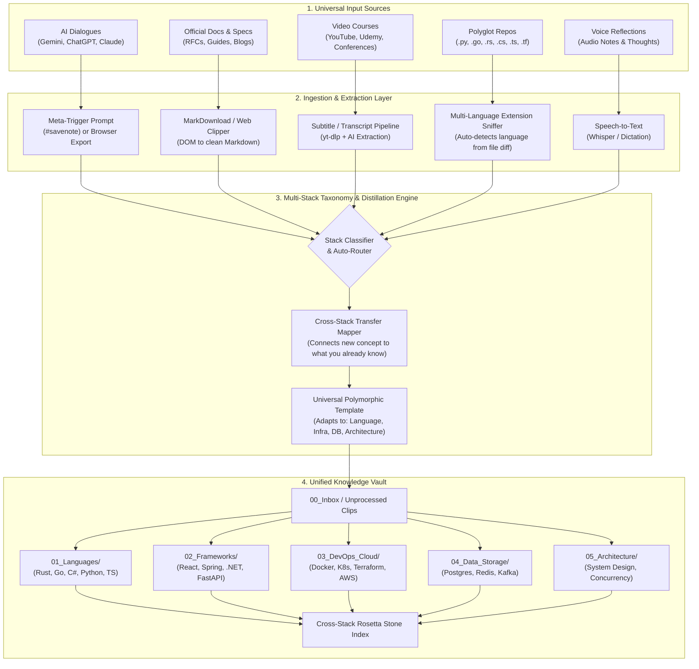
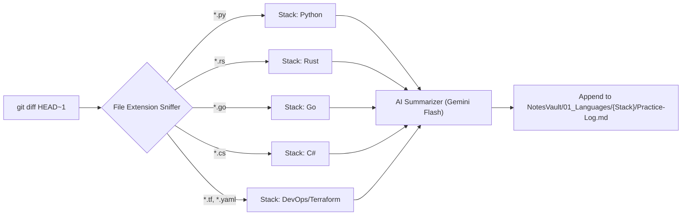

# Stack-Agnostic Automated Note-Taking Architecture & Multi-Stack Plan

> [!NOTE]
> This system is built to be **100% tech-stack agnostic**. Whether you are learning systems programming (Rust, Go, C#), scripting & AI (Python), frontend (TypeScript, React), infrastructure (Docker, Kubernetes, Terraform), databases (PostgreSQL, Redis, Kafka), or System Design, the architecture classifies, structures, and links notes identically across all learning curves.

---

## 1. Multi-Stack System Architecture



---

## 2. Multi-Stack Classification Taxonomy

The system categorizes any technology into one of five universal domains:

```
Tech Universe
 ├── 1. Languages (Syntax, Memory Model, Concurrency, Type System)
 │    └── Examples: Rust, Go, C#, Python, TypeScript, Java, C++
 ├── 2. Frameworks & Runtimes (APIs, Lifecycles, Component Architecture)
 │    └── Examples: React, Next.js, ASP.NET Core, Spring Boot, FastAPI, Node.js
 ├── 3. DevOps, Cloud & Tooling (Manifests, Deployment, Networking, CI/CD)
 │    └── Examples: Docker, Kubernetes, Terraform, GitHub Actions, AWS, GCP
 ├── 4. Data & State (Querying, Indexing, Consistency, ACID/BASE)
 │    └── Examples: PostgreSQL, Redis, Apache Kafka, MongoDB, DynamoDB
 └── 5. Architecture & Fundamentals (Trade-offs, Protocols, Patterns)
      └── Examples: System Design, Distributed Systems, Event-Driven, Microservices
```

---

## 3. The "Rosetta Stone" Concept (Cross-Stack Transfer Learning)

The single fastest way to learn a new stack is **conceptual analogy** (mapping new concepts to things you already understand).

The distillation engine is explicitly configured to ask:
> *"How does this concept compare to its equivalent in other major stacks?"*

### Conceptual Mapping Matrix:
| Domain Concept | In C# / .NET | In Go | In Python | In Rust |
| :--- | :--- | :--- | :--- | :--- |
| **Concurrency Primitive** | `async` / `await` (`Task`) | Goroutines & Channels | `asyncio` (`async`/`await`) | `async` / `await` (`Future`) |
| **Package Management** | NuGet (`.csproj`) | Go Modules (`go.mod`) | UV / Poetry (`pyproject.toml`) | Cargo (`Cargo.toml`) |
| **Type Invariance / Interfaces** | Interfaces (`interface IFoo`) | Implicit Interfaces | Protocols / Abstract Base Classes | Traits (`pub trait Foo`) |
| **Error Handling** | Exceptions (`try/catch`) | Explicit values (`if err != nil`) | Exceptions (`try/except`) | `Result<T, E>` & `Option<T>` |
| **Container & Process Model** | ASP.NET Kestrel inside Docker | Single compiled binary in distroless | Gunicorn/Uvicorn in container | Single compiled binary in scratch |

---

## 4. Universal Polymorphic Note Schema

This schema automatically accommodates programming languages, infrastructure configs, databases, and system design topics without modification.

```markdown
---
topic: "Goroutines vs Thread Pools"
stack: "Go"
category: "Languages / Concurrency"
tags: ["go", "concurrency", "performance", "runtime"]
source_type: "AI_Chat" # AI_Chat | Documentation | Video | Code_Diff
source_ref: "https://... or Gemini chat session"
date: 2026-11-16
status: "seeded" # seeded -> reviewing -> mastered
---

# [Topic Name]

## 1. Mental Model (Why does this exist?)
<!-- 2-3 sentences explaining the core problem it solves and what trade-off it makes -->

## 2. Cross-Stack Translation (Rosetta Stone)
<!-- How does this compare to other languages/stacks you know? -->
- **Equivalent in Stack A**: How it relates (e.g., "Like C#'s ThreadPool, but multiplexed onto OS threads in userspace").
- **Equivalent in Stack B**: (e.g., "Like Node.js event loop, but multi-threaded natively").

## 3. Minimal Copy-Pasteable Implementation
<!-- Runnable code snippet, Dockerfile, Terraform block, or SQL query -->
```[language/hcl/yaml/sql]
// Minimal, production-grade example illustrating core syntax
```

## 4. Key Rules & Architectural Behaviors
- **Memory / Performance Impact**: Cost, allocations, or operational overhead.
- **Runtime Lifecycle**: How initialization, execution, and cleanup behave.

## 5. Gotchas & Anti-Patterns
- ⚠️ Pitfall 1 (e.g., Goroutine leaks, memory fragmentation, missing indexes).
- ⚠️ Anti-pattern to avoid in production.

## 6. API / Syntax / CLI Reference Sheet
| Syntax / Command / Directive | Function | Example |
| :--- | :--- | :--- |
| `go worker()` | Spawns lightweight thread | `go processJob(id)` |

## 7. Real-World Production Context
- When should you use this vs alternatives?
```

---

## 5. Universal Vault Layout

A clean, future-proof directory structure that scales smoothly from 1 stack to 20 stacks:

```text
NotesVault/
├── 00_Inbox/                        # Unsorted AI captures, web clips, voice dumps
├── 01_Languages/                    # Core programming languages
│   ├── Go/
│   ├── Rust/
│   ├── CSharp/
│   ├── Python/
│   └── TypeScript/
├── 02_Frameworks/                   # Frameworks, SDKs, and Runtimes
│   ├── React/
│   ├── DotNet/
│   ├── FastAPI/
│   └── SpringBoot/
├── 03_DevOps_Cloud/                 # Infrastructure, deployment, containers
│   ├── Docker/
│   ├── Kubernetes/
│   ├── Terraform/
│   └── AWS_GCP/
├── 04_Data_Storage/                 # Relational, NoSQL, caches, message buses
│   ├── PostgreSQL/
│   ├── Redis/
│   └── Kafka/
├── 05_Architecture/                 # Stack-independent fundamentals
│   ├── DistributedSystems/
│   ├── Security_Auth/
│   └── SystemDesign/
├── 06_Projects/                     # Practical projects you build across stacks
│   ├── GoMicroservice/
│   ├── CSharpEmployeeAPI/
│   └── RustCLI/
└── 99_Templates/              # Standardized templates & prompts
    └── Universal-Tech-Note.md
```

---

## 6. Agnostic Ingestion Implementation

### 6.1 Multi-Stack AI Custom Instruction (Gemini / ChatGPT)
Add this exact prompt into your ChatGPT/Gemini Custom Instructions or use it at the end of any conversation:

```text
Whenever I say "#savenote" or "generate note":
1. Identify the technology stack and its domain (Language, Framework, Cloud/DevOps, Database, or System Architecture).
2. Synthesize our conversation into a clean, markdown note following this schema:
   - Topic & Domain
   - Mental Model (Core problem solved + trade-offs)
   - Cross-Stack Comparison (Compare this concept to equivalents in other major languages/frameworks)
   - Minimal Working Syntax (Code, YAML, Dockerfile, or SQL)
   - Architectural Rules & Lifecycle
   - Gotchas, Pitfalls & Anti-Patterns
   - Cheat Sheet Table
3. Do not include conversational remarks or greetings. Output raw markdown only.
```

### 6.2 Language-Agnostic Git Commit Analyzer
A simple cross-platform CLI tool (runnable in any repository) that automatically recognizes the language based on modified files:



---

## 7. Multi-Stack Learning Workflow (Putting It Into Practice)

1. **Studying a Concept on Gemini/ChatGPT** (e.g., Goroutines in Go, or Ownership in Rust):
   * Chat, ask edge questions, debug samples.
   * Type `#savenote`.
   * Copy the output or export it with a 1-click Markdown extension into `00_Inbox/`.
2. **Reading Documentation** (e.g., Kafka documentation or Kubernetes Pod specs):
   * Clip relevant documentation using **MarkDownload**.
   * Run the Markdown through the universal template.
3. **Building Code in any language**:
   * Commit your code. The commit script detects the file types and records the learned patterns in your notes vault.
4. **Weekly 10-Minute Vault Tidy-up**:
   * Review notes in `00_Inbox/` and move them into their respective stack folder (`/01_Languages/Rust`, `/03_DevOps_Cloud/Docker`, etc.).
