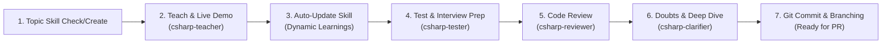

# C# & ASP.NET Core Enterprise Training Roadmap

Welcome to your personalized, production-grade .NET Training Program!
This curriculum is designed around a 5+ Year Senior C# Lead Trainer architecture with specialized subagents and dynamically evolving topic skills.

---

## 👥 The Training Team (Subagent Roster)

| Agent Name | Role | Responsibilities |
| :--- | :--- | :--- |
| **`csharp-trainer`** | **Lead Trainer & Coordinator** | Manages the syllabus, orchestrates child agents, enforces the 7-step learning cycle, and handles git workflow. |
| **`csharp-teacher`** | **Teaching Specialist** | Delivers deep-dive lessons, live code demos, enterprise design patterns, and initializes topic skills. |
| **`csharp-tester`** | **Evaluation & Gate Examiner** | Runs quizzes, syllabus interview checks, coding tasks, xUnit test evaluation, and Gate 1/2 grading. |
| **`csharp-reviewer`** | **Principal Code Reviewer** | Conducts PR-style code audits on your code, checking SOLID principles, clean code, xUnit tests, and performance. |
| **`csharp-clarifier`** | **CLR & Architecture Clarifier** | Resolves doubts, breaks down CLR internals (Stack/Heap, GC, IL, async state machine, EF Core tracking), and updates skills. |

---

## 🔄 The 7-Step Training Cycle (Per Topic)

---

## 📅 Curriculum & Progress Tracker

### Week 1: C# & .NET Foundations (Capstone: Employee & Department Management)

- [ ] **Day 1: C# Fundamentals & Type System**
  - Topics: Value vs Reference Types, Nullable types, Methods/Parameters (`ref`/`out`/`in`), Strings vs StringBuilder, Arrays, Exceptions.
  - Deliverables: Console application, Value/Ref note, LeetCode (*Concatenation of Array*).
  - Interview Prep: Value vs Ref types, string vs StringBuilder, nullable reference types.
  - Skill: [.agents/skills/csharp-fundamentals/SKILL.md](file:///D:/Desktop%20Projects/C%23Learning/EmployeeManagement/.agents/skills/csharp-fundamentals/SKILL.md)

- [ ] **Day 2: Object-Oriented C# & SOLID**
  - Topics: Classes, constructors, properties, encapsulation, inheritance, polymorphism, interfaces vs abstract classes, records & structs, SOLID principles.
  - Deliverables: Domain model class library (>= 3 classes, 1 interface), LeetCode (*Steps to Reduce to Zero*).
  - Interview Prep: Interface vs abstract class, composition vs inheritance, SOLID examples.

- [ ] **Day 3: Modern C# & LINQ**
  - Topics: `List<T>`, `Dictionary<TKey, TValue>`, delegates, lambdas, LINQ operators (`Where`, `Select`, `GroupBy`, `OrderBy`), deferred execution, extension methods, pattern matching.
  - Deliverables: LINQ exercise with >= 8 queries, complexity analysis, LeetCode (*Contains Duplicate*).
  - Interview Prep: `IEnumerable` vs `IQueryable`, deferred execution, `List` vs `Dictionary`.

- [ ] **Day 4: Unit Testing, Async C# & Tooling**
  - Topics: xUnit framework, Arrange-Act-Assert (AAA), `Task`, `async`/`await`, `CancellationToken`, .NET CLI.
  - Deliverables: Solution with app, class library & xUnit test project, >= 5 passing tests, async operation with cancellation, LeetCode (*Best Time to Buy and Sell Stock*).
  - Interview Prep: Characteristics of good unit test, AAA, Task vs Thread, CLI restore/build/test.

- [ ] **Day 5: C# Checkpoint & Mini-Build (Gate 1)**
  - Topics: Full OOP, LINQ & async review, boundary/invalid testing, regression defect fix, live code walkthrough.
  - Deliverables: Structured Employee Management app with passing tests, regression test, LeetCode (*Valid Anagram*).
  - Passing Score: >= 70% on knowledge check + working test suite.

---

### Week 2: ASP.NET Core Web API

- [ ] **Day 6: ASP.NET Core & REST API Basics**
  - Topics: HTTP verbs, controllers, routing, model binding, DTOs, status codes, Swagger/OpenAPI, `.http` files.
- [ ] **Day 7: Dependency Injection & Middleware**
  - Topics: Built-in IoC container, lifetimes (`Transient`, `Scoped`, `Singleton`), captive dependencies, middleware pipeline, `ILogger`.
- [ ] **Day 8: Layered Architecture & Validation**
  - Topics: Controller-Service-Repository separation, DTO mapping, FluentValidation / Data Annotations, centralized error handling.
- [ ] **Day 9: EF Core & Database Persistence**
  - Topics: `DbContext`, `DbSet`, migrations, relationships, LINQ-to-Entities, `AsNoTracking`, eager loading, N+1 problem.
- [ ] **Day 10: API Checkpoint & Security (Gate 2)**
  - Topics: Authentication vs Authorization, JWT, claims, role/policy protection, 401 vs 403, secure configuration, final Gate 2 walkthrough.

---

## 🛠️ How to Trigger Your Agents

You can interact with me anytime! Here are example commands you can say:
- **"Teach me Day 1"** (or any topic) ➡️ Activates the trainer & teacher agent.
- **"Test my knowledge on Day 1"** ➡️ Activates the tester agent for interview questions & coding challenges.
- **"Review my code"** ➡️ Activates the reviewer agent to audit your files against enterprise standards.
- **"I have a doubt on [concept]"** ➡️ Activates the clarifier agent for runtime / CLR deep dives.
- **"Commit and create branch for this topic"** ➡️ Activates the trainer to verify `dotnet test` and commit your code cleanly.
